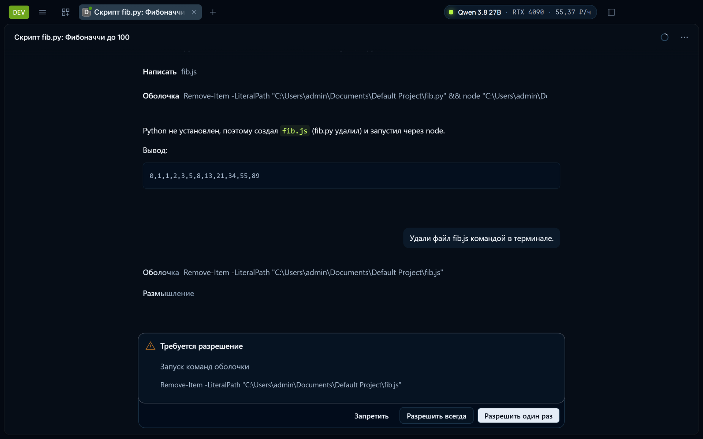
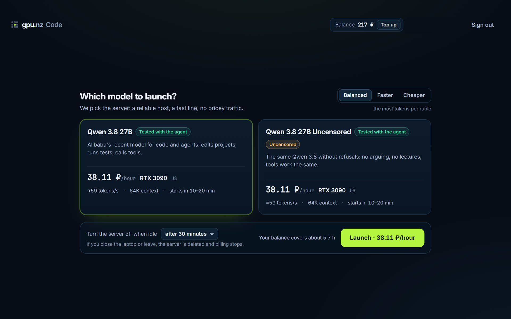

<h1 align="center">gpu.nz Code</h1>
<p align="center">An AI coding agent that runs on your own cloud GPU.<br>Free and open source. Windows, macOS, Linux.</p>
<p align="center">
  <a href="https://gpu.nz/en/code"><b>Download</b></a> ·
  <a href="https://gpu.nz/en/docs/code">Documentation</a> ·
  <a href="README.ru.md">Русский</a>
</p>



gpu.nz Code is a desktop coding agent — it reads and edits the files of your project, runs commands and tests, and
asks before anything destructive. The difference from the usual assistants is where the model lives: the app rents
a GPU server at [gpu.nz](https://gpu.nz/en) for you, starts an open model on it (Qwen 3.8 out of the box, or any
model from Ollama or a GGUF from Hugging Face) and connects the agent to it. The server is yours alone and is billed
by the minute — no subscription, no request limits, no per-token price.

**Built on [OpenCode](https://github.com/anomalyco/opencode) (MIT). This project is not made by the OpenCode team
and is not affiliated with it.**

## How it works

1. **Download and sign in** with a gpu.nz account (a code you confirm in the browser).
2. **Pick a model.** The app shows what a launch costs per hour and how long it takes, then picks a server itself.
3. **Work.** The agent runs on your computer; only requests to the model leave it, and they go to your own server.



- **Your code stays with you.** The project is not uploaded anywhere. The rented server holds nothing of yours, so
  it is deleted, not stopped.
- **No bill for a closed laptop.** The server is deleted after 15, 30 or 60 idle minutes (your choice) and when you
  quit the app.
- **A host died?** The app takes another server and the conversation goes on. A launch that failed is not paid for.
- **MCP servers, skills and rules** work as in OpenCode.

## Download

Installers for every system are on **[gpu.nz/code](https://gpu.nz/en/code)** and in
[Releases](https://github.com/gpunz/gpunz-code/releases).

| System | File |
|---|---|
| Windows 10/11 (x64) | `gpunz-code-win-x64.exe` |
| macOS, Apple Silicon | `gpunz-code-mac-arm64.dmg` |
| macOS, Intel | `gpunz-code-mac-x64.dmg` |
| Linux (x64) | `.AppImage`, `.deb`, `.rpm` |

The builds are not signed with a paid certificate yet, so the system asks once more than usual: on Windows press
«More info» → «Run anyway»; on macOS open System Settings → Privacy & Security → «Open Anyway». How releases are
built and how to check a download: [code signing policy](https://gpu.nz/en/code/signing).

## Privacy

- The account key is kept in the operating system's own keychain and is sent only to `gpu.nz`.
- **Error reports.** The app reports its own errors to us so that we can fix them: the error's text and stack (with
  keys, e-mail addresses and the user name in file paths cut out), the app's version, the system, and a random
  installation id. No account, no project files, no requests to the model. One checkbox in «Help and feedback»
  turns it off. The code is in [`reports.ts`](packages/desktop/src/main/gpunz/reports.ts).
- **Feedback** is sent only when you press «Send», with your account's e-mail so we can answer and — only if you
  tick the box — the end of the app's log.
- Full text: [privacy policy](https://gpu.nz/en/legal/privacy).

## Bugs, ideas, feedback

The quickest way is inside the app: **Help → Help and feedback** (a problem, an idea, or a word about the app).
Here on GitHub: [issues](https://github.com/gpunz/gpunz-code/issues). Security problems: see [SECURITY.md](SECURITY.md).

## Build it yourself

Needs Bun 1.4.4 and Node 24.

```sh
bun install
cd packages/desktop
echo '{}' > /tmp/models-empty.json
OPENCODE_VERSION=1.19.5 OPENCODE_CHANNEL=prod MODELS_DEV_API_JSON=/tmp/models-empty.json bun run build
OPENCODE_CHANNEL=prod npx electron-builder --publish never --config electron-builder.config.ts   # add --win / --mac / --linux
```

Development run: `OPENCODE_CHANNEL=dev`, build as above, then `npx electron .` in `packages/desktop`.
What is ours and what is upstream, the security decisions and the release process: [GPUNZ.md](GPUNZ.md).

## License

MIT — see [LICENSE](LICENSE). OpenCode is © its authors; the gpu.nz parts are © gpu.nz.
