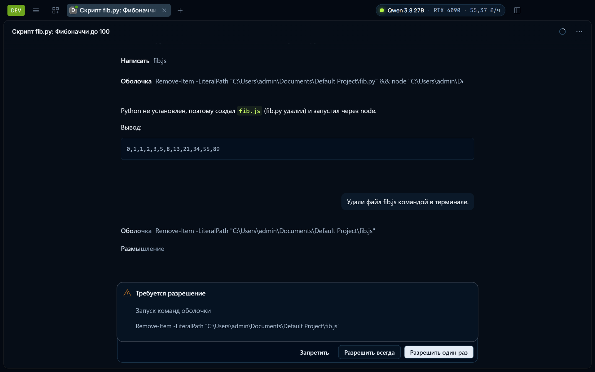
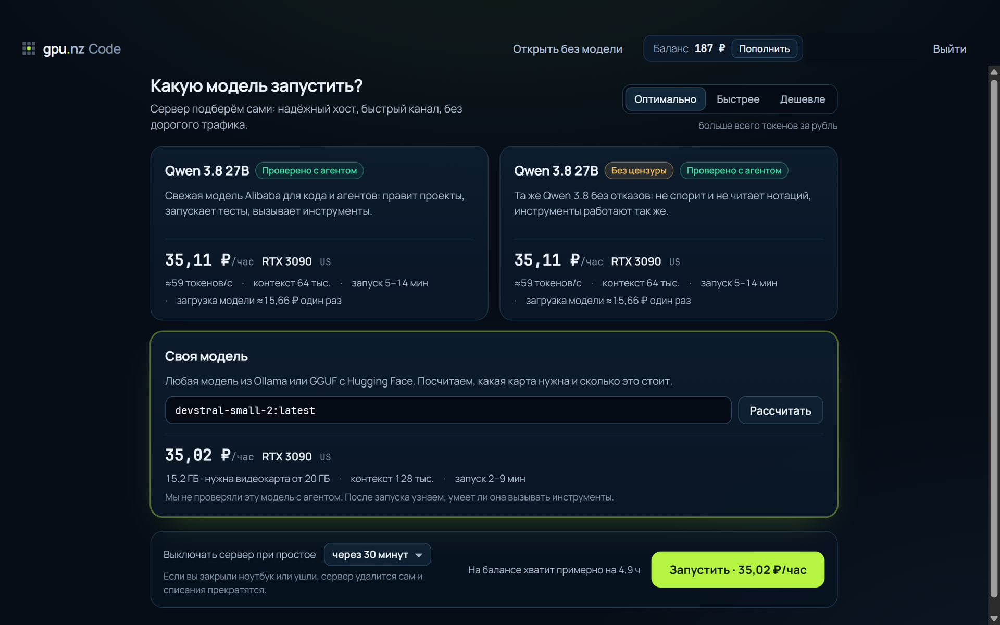

<h1 align="center">gpu.nz Code</h1>

ИИ-агент для программирования на вашей собственной видеокарте в облаке. Бесплатно, с открытым исходным кодом. Windows, macOS, Linux.

  <a href="https://gpu.nz/code"><b>Скачать</b></a> ·
  <a href="https://gpu.nz/docs/code">Документация</a> ·
  <a href="README.md">English</a>

gpu.nz Code — настольный агент для программирования: читает и правит файлы проекта, запускает команды и тесты,
перед опасными действиями спрашивает. От привычных ассистентов он отличается тем, где работает модель: приложение
само арендует для вас сервер с видеокартой на [gpu.nz](https://gpu.nz), запускает на нём открытую модель (Qwen 3.8
из коробки или любую из Ollama и GGUF с Hugging Face) и подключает к ней агента. Сервер только ваш, оплата
поминутная — без подписки, без лимитов на запросы и без цены за токены.

**Сделано на основе [OpenCode](https://github.com/anomalyco/opencode) (MIT). Проект не создан командой OpenCode
и не связан с ней.**

## Как это работает

1. **Скачайте и войдите** в аккаунт gpu.nz (код подтверждается в браузере).
2. **Выберите модель.** Приложение покажет цену в час и время запуска и само подберёт сервер.
3. **Работайте.** Агент выполняется на вашем компьютере; наружу уходят только запросы к модели — на ваш сервер.

- **Код остаётся у вас.** Проект никуда не загружается. На арендованном сервере ничего вашего нет, поэтому он
  удаляется, а не останавливается.
- **Закрытый ноутбук не тратит деньги.** Сервер удаляется после 15, 30 или 60 минут простоя (на выбор) и при
  выходе из приложения.
- **Хост упал?** Приложение возьмёт другой сервер, разговор продолжится. Неудачный запуск не оплачивается.
- **MCP-серверы, скиллы и правила** работают как в OpenCode.

## Скачать

Установщики для всех систем — на **[gpu.nz/code](https://gpu.nz/code)** и в
[Releases](https://github.com/gpunz/gpunz-code/releases).

Сборки пока без платной подписи, поэтому система переспросит: в Windows нажмите «Подробнее» → «Выполнить в любом
случае»; в macOS откройте Системные настройки → Конфиденциальность и безопасность → «Всё равно открыть». Как
собираются выпуски и как проверить загрузку: [политика подписи кода](https://gpu.nz/code/signing).

## Приватность

- Ключ аккаунта хранится в системном хранилище ключей и отправляется только на `gpu.nz`.
- **Отчёты об ошибках.** Приложение сообщает нам о своих ошибках, чтобы мы их исправляли: текст и стек ошибки
  (ключи, адреса почты и имя пользователя в путях вырезаются), версия приложения, система и случайный номер
  установки. Без аккаунта, без файлов проекта и запросов к модели. Отключается галочкой в окне «Помощь и обратная
  связь». Код — в [`reports.ts`](packages/desktop/src/main/gpunz/reports.ts).
- **Отзывы** отправляются только по кнопке «Отправить»: с почтой аккаунта, чтобы мы могли ответить, и — только если
  вы поставили галочку — с концом журнала приложения.
- Полный текст: [политика конфиденциальности](https://gpu.nz/legal/privacy).

## Ошибки, идеи, отзывы

Быстрее всего — из приложения: **Справка → Помощь и обратная связь**. Здесь, на GitHub:
[issues](https://github.com/gpunz/gpunz-code/issues). Проблемы безопасности: [SECURITY.md](SECURITY.md).

## Сборка из исходников

См. [README.md](README.md#build-it-yourself) и [GPUNZ.md](GPUNZ.md).

## Лицензия

MIT — см. [LICENSE](LICENSE). OpenCode © его авторы; части gpu.nz © gpu.nz.
